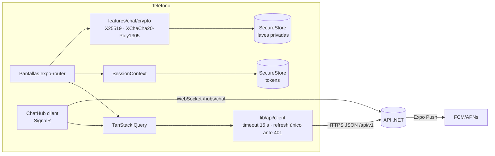

# Arquitectura — Encorely móvil (rama `rebuild/v1`)

App nativa Android/iOS con Expo SDK 57 (React Native 0.86, React 19.2, TypeScript estricto). La web de Expo no es objetivo. El back es `encorly_back` (.NET 10) y el contrato entre ambos es `encorly_back/contracts/openapi.v1.json`.

## Capas y carpetas

| Carpeta | Qué vive ahí | Regla |
|---|---|---|
| `src/app/` | Rutas de expo-router. Delgadas: importan la pantalla de su feature | Sin lógica de negocio |
| `src/features/<dominio>/` | Pantallas, componentes, hooks y lógica pura de cada dominio: `auth`, `onboarding`, `discover`, `events`, `match`, `chat`, `profile`, `safety`, `push`, `spotify` | Un dominio no edita archivos de otro; reutiliza por su `index.ts` |
| `src/ui/` | Design system "La boleta compartida": tokens, tema, primitivas, iconos | Única fuente de colores, tipos, espacios y radios |
| `src/lib/` | Configuración, cliente API, tipos del contrato, sesión, Query, red | Sin UI salvo el aviso de red |

## Navegación

`Stack` raíz con tres grupos protegidos por la sesión (`Stack.Protected`):

- `(auth)`: bienvenida, entrar, crear cuenta.
- `(onboarding)`: datos básicos y géneros. Se sale cuando el back marca `onboardingCompleted`.
- `(app)`: `Stack` con las tabs nativas (*Descubrir · Conciertos · Chats · Tú*) y, apiladas encima, las pantallas de detalle (concierto, match, chat, verificación, ajustes). Así hay swipe-back en iOS, la tab bar no tapa contenido y un push abre el chat con historial.

El splash se mantiene hasta resolver fuentes y sesión: no hay destello del login ni del onboarding.

## Sesión y red

- **Una sola sesión** (`lib/session/SessionContext.tsx`). En el dispositivo solo se guardan los tokens (SecureStore, `WHEN_UNLOCKED_THIS_DEVICE_ONLY`) y las llaves del chat. Todo lo demás sale del API: un teléfono compartido no filtra datos entre usuarios.
- **Refresh rotativo**: el cliente renueva el access token antes de que venza y, ante un 401, hace **un solo** refresh en vuelo (varias peticiones simultáneas no rotan varias veces, lo que haría que el back revocara la familia). Si el refresh es rechazado, la sesión se cierra con el aviso "Tu sesión se cerró" en vez de dejar la app colgada.
- Peticiones con timeout de 15 s, un reintento en GET ante corte de red, errores `ProblemDetails` traducidos a texto para la persona (nunca "API 401") y ramificación por `code` estable.
- TanStack Query para el estado de servidor, enlazado a NetInfo (reintenta al volver la red) y a AppState (refresca al volver a la app). Aviso "Sin conexión" global.
- Los tipos del cliente se **generan** del contrato: `pnpm gen:api` → `src/lib/api/schema.d.ts`; `types.ts` solo da nombres legibles.

## Chat cifrado de extremo a extremo

### Protocolo (v1)

| Pieza | Decisión |
|---|---|
| Identidad | Ed25519 por usuario y dispositivo, generada en el teléfono |
| Llave de caja | X25519 con `boxKeyId` creciente, firmada por la identidad: `Ed25519(“ENCORELY-BOXKEY-v1” ‖ u32be(boxKeyId) ‖ boxKey)`. El cliente **siempre** verifica la firma de las llaves que recibe |
| Llave del par | `HKDF-SHA256(X25519(mi_privada, publica_del_otro), salt = matchId, info = “ENCORELY-CHAT-v1”)` |
| Cifrado | XChaCha20-Poly1305 con nonce aleatorio de 24 B por mensaje |
| AAD | `“ENCORELY-MSG-v1” ‖ versión ‖ id ‖ 0 ‖ matchId ‖ 0 ‖ remitente ‖ 0 ‖ u32 llave del remitente ‖ u32 llave del destinatario`: el servidor no puede mover un mensaje a otra conversación ni cambiar su remitente sin que falle el descifrado |
| Texto interno | JSON `{v, id, m, s, r, t, k, b}` + llave de franking, con padding ISO/IEC 7816-4 a múltiplos de 256 B (oculta la longitud) |
| Franking | `HMAC-SHA256(fk, “ENCORELY-FRANK-v1” ‖ UUID ‖ texto interno)`: un reporte adjunta texto + `fk` y moderación comprueba que el mensaje es auténtico sin poder leer nada más |
| Código de seguridad | 60 dígitos (12 bloques de 5) derivados de SHA-256 de cada identidad, ordenados por userId; también como QR para escanear en persona |
| Librerías | `@noble/curves`, `@noble/ciphers`, `@noble/hashes` (JS puro, auditadas por Cure53). `crypto.getRandomValues` lo provee `expo-crypto` |

Todo el cifrado vive en `src/features/chat/crypto/envelope.ts`. Ningún `console.*` en `crypto/` ni `keys/` (regla de ESLint).

### Llaves en el dispositivo

- Privadas en SecureStore namespaced por usuario (`e2ee_v1_<userId>_…`), solo accesibles con el teléfono desbloqueado y excluidas del backup de Android.
- iOS conserva el Keychain tras desinstalar: un `installId` en AsyncStorage detecta la reinstalación y regenera llaves en vez de reutilizar las viejas.
- Las llaves de contactos se fijan (*pinning*): primera vez = sin verificar; misma identidad con caja nueva firmada = rotación normal; identidad distinta = **cambio**, que se avisa en el chat y, si el contacto estaba verificado, bloquea el envío hasta que la persona lo acepte. Los pines llevan un índice por usuario (`e2ee_v1_<userId>_peers`) para poder borrarlos todos.
- Al cerrar sesión se conservan llaves, pines e historial (para leerlos al volver a entrar en ese teléfono); al **borrar la cuenta** se destruyen las llaves, los pines (`peerKeys.wipeAll`) y la base local con su llave.

### Historial local cifrado y ack (v1.1)

- `src/features/chat/local/`: una base SQLite por usuario (`encorely_chat_<userId>.db`) abierta con **SQLCipher** (`expo-sqlite` con `useSQLCipher`, requiere build nativo). La llave de la base son 32 B aleatorios en SecureStore (`e2ee_v1_<userId>_dbkey`, `WHEN_UNLOCKED_THIS_DEVICE_ONLY`) y se pasa en crudo (`PRAGMA key = "x'…'"`). Si el llavero no se puede leer, la base no se abre y no se crea otra llave.
- Tabla `messages (id, match_id, seq, sender_id, sent_at, kind, body, p, fk, status, envelope)` con índice `(match_id, seq)` y `sync_state (match_id, synced_seq, acked_seq, completed_at)`. Paginación local por keyset (`seq < ?`). `p`/`fk` guardan la evidencia de franking para reportes; `envelope` guarda el sobre de lo que no se pudo abrir.
- Flujo (`data/localSync.ts`): `GET messages?after=synced_seq` → descifrar → guardar → **luego** `POST /matches/{id}/messages/ack {upToSeq}` y el servidor borra lo recibido. Lo que no se pudo abrir también se guarda (con su sobre) antes del ack, para no perderlo. La pantalla lee de la base: sin red se ve lo guardado.
- El cursor es `synced_seq` (hasta dónde se leyó el servidor sin huecos), no el seq más alto visto: un envío propio confirmado puede tener un seq mayor que un mensaje del otro que todavía no llegó.
- Los envíos propios se guardan al confirmarse: el servidor los conserva solo hasta que el otro hace ack.
- Migración suave: si la base no abre (o no existe el módulo nativo), el chat funciona como en v1: solo servidor, sin ack, sin rotación. La primera sincronización de un match con base importa todo lo que el servidor aún guarda.
- Lógica probada en Jest contra un store en memoria con la misma semántica (`local/memoryStore.ts`); la capa `expo-sqlite` (`local/sqliteStore.ts`) es delgada.

### Rotación por cadena (protección parcial de mensajes anteriores)

- `chain_{n+1} = HKDF-SHA256(chain_n, info “ENCORELY-BOXCHAIN-v1”)`, `box_priv_n = HKDF-SHA256(chain_n, info “ENCORELY-BOXKEY-v1”)` (clamp de X25519 en noble). Las instalaciones nuevas arrancan con cadena; las v1 (cajas aleatorias) arrancan una cadena desde semilla aleatoria en su primera rotación.
- Cada 7 días (al arrancar o al volver a la app, `data/keyMaintenance.ts`): siguiente eslabón, firma, `PUT /keys/me` con `boxKeyId` estrictamente creciente. El eslabón viejo se sobrescribe en el llavero.
- Las cajas privadas viejas se borran solo cuando: el servidor confirmó la caja vigente (desde ahí rechaza sobres a las anteriores con `stale_recipient_key`), cada match activo se sincronizó completo **después** de esa confirmación, todo quedó en la base local y el ack respondió bien. Si algo falla a mitad, no se borra nada; lo que no se pudo abrir conserva su llave. Sin base local no se rota.
- Si otro teléfono con la misma cadena (traspaso) rotó, este adopta la caja del servidor derivando hasta 16 eslabones, sin volver a subir (sin ping-pong).
- **Límite real**: es protección gruesa por semana, no por mensaje. Quien robe la llave vigente lee lo cifrado con ella (hasta 7 días, más si la app no se abre) y lo que siga llegando hasta la próxima rotación; la identidad Ed25519 no rota. Un respaldo en el servidor conserva las llaves del momento en que se creó.

### Respaldo cifrado opcional

- `PUT/GET/DELETE /me/backup` y `GET /me/backup/info`. Cifrado en el teléfono: **scrypt** (`N = 2^14, r = 8, p = 1`, 16 MiB; bajado de 2^15 tras medir ~100 s en el emulador; en el contrato `opsLimit = N`, `memLimit = 128·r·N`) → XChaCha20-Poly1305 con AAD `“ENCORELY-BACKUP-v1” ‖ versión ‖ algoritmo ‖ parámetros ‖ sal` (cambiar los parámetros en el servidor rompe el descifrado). La frase se normaliza (espacios, NFC) y nunca sale del teléfono.
- Por qué scrypt y no argon2id: con `@noble/hashes` 2.4 en un intérprete sin JIT (aproximación a Hermes), argon2id con el mínimo de OWASP (19 MiB, t=2) tardó ~9 s y con 64 MiB/t=3 pasaría de 30 s; scrypt 32 MiB tardó ~11 s y corre en trozos (`scryptAsync`) sin congelar la UI. Los parámetros viajan con el blob: se pueden subir sin romper respaldos viejos. Al restaurar se acotan (N ≤ 2^20, r ≤ 32).
- Contenido: identidad, cadena vigente, cajas vigentes y, opcional, el historial (máx. 10 MiB; se avisa el tamaño). Restaurar valida que sea de la misma cuenta, instala, publica una caja por encima del servidor e importa el historial. Frase mínima: 4 palabras o 16 caracteres. "Si olvidas la frase, nadie puede recuperar tus mensajes, ni nosotros."

### Traspaso a otro teléfono

- `/keys/link-requests`. El nuevo crea una X25519 efímera, abre el buzón (10 min, un solo uso) y muestra `encorely-link:v1:<id>:<pública b64url>`. El viejo escanea, comprueba que la efímera del buzón es **la misma** del QR, cifra identidad + cadena + cajas vigentes con X25519 + HKDF (`“ENCORELY-LINK-v1”`) + XChaCha20-Poly1305 (AAD = id del buzón) y hace `PUT`. El nuevo descifra, valida (cada privada produce su pública, cada caja firmada por la identidad, la cadena produce su caja), instala, borra la efímera y el buzón y publica.
- Código corto de 6 dígitos = SHA-256(`“ENCORELY-LINKCODE-v1”` ‖ efímera nueva ‖ efímera del viejo). Los dos teléfonos lo muestran; el nuevo **solo instala si la persona confirma que coinciden**, así el servidor no puede colar material propio.
- Es traspaso, no multi-dispositivo: los dos teléfonos comparten la misma identidad. Como el ack borra del servidor, si se usan los dos cada mensaje queda solo en el que lo descargue primero. El historial viaja por el respaldo, no por el traspaso.

### Modelo de amenazas

| Amenaza | ¿Protege? | Por qué |
|---|---|---|
| Servidor curioso o admin de la BD | **Sí, el contenido** | Solo hay ciphertext y se borra tras el ack. Sigue viendo quién habla con quién, cuándo y el tamaño aproximado (con padding a 256 B) |
| Volcado de la BD | **Sí** | Sin las llaves privadas el ciphertext no sirve |
| Volcado de la BD y luego robo de la llave vigente | **Parcial** | Lo cifrado a cajas ya borradas no se descifra; lo de la semana vigente (y lo que llegue hasta rotar) sí |
| Servidor que sustituye una llave pública | **Parcial** | Se detecta si comparan el código de seguridad (o el QR) en persona |
| Servidor que interfiere en un traspaso | **Sí** | QR fuera de banda + código de 6 dígitos confirmado en el teléfono nuevo |
| Servidor con el respaldo | **Sí, si la frase es buena** | scrypt + AEAD; una frase débil se puede atacar fuera de línea (por eso el mínimo) |
| MITM de red | **Sí** | TLS + E2EE |
| Robo de la contraseña | **Parcial** | El atacante publica una llave nueva: el contacto ve el aviso de cambio |
| Teléfono robado y bloqueado | **Sí** | Keystore/Keychain solo con desbloqueo; la base local es inútil sin su llave |
| Teléfono desbloqueado o con malware | **No** | Ningún E2EE protege un dispositivo comprometido (ve historial y llaves) |
| Acoso o spam | **Parcial** | Chat solo con match mutuo, bloquear y reportar con franking |
| Notificaciones push | **Sí** | El payload no lleva contenido, nombre ni texto |

### Límites declarados (también en la app: *Tú → Cómo protegemos tus chats* y en la verificación)

- **Protección parcial de mensajes anteriores.** La llave cambia cada 7 días y las anteriores se borran del teléfono cuando ya guardaste esos mensajes. Quien robe la llave vigente puede leer lo cifrado con ella. No es por mensaje.
- **El historial vive en el teléfono.** Sin respaldo, perder el teléfono o desinstalar borra ese historial (el servidor ya lo borró).
- **Respaldo opcional con frase**: si se olvida, nadie lo recupera. Mientras exista, quien tenga la frase lee los mensajes de esa época.
- **Traspaso, no varios teléfonos**: misma identidad en ambos; el historial viaja por el respaldo.
- **Verificación manual**: se compara el código o se escanea el QR en persona. La rotación semanal no cambia el código de seguridad.
- El producto dice "cifrado de extremo a extremo", nunca "como Signal".

## Diseño: "La boleta compartida"

Tokens en `src/ui/tokens.ts` (paletas *venue* oscura y *papel* clara verificadas para AA, escala de 4 pt, 3 radios, Big Shoulders Display + Archivo + IBM Plex Mono, motion). La boleta con muesca (`TicketCard`) solo aparece en match, concierto y verificación del chat. Iconos Phosphor por imports profundos (`src/ui/icons.ts`). Sin emojis, gradientes de color, glow ni blur. Sin datos inventados: lo que no viene del API no se muestra.

## Pruebas

`pnpm verify` = `tsc` + ESLint + Jest. La cripto tiene pruebas de ida y vuelta, llave equivocada, bits alterados en ciphertext/nonce/AAD, sobre movido de conversación, remitente cambiado, franking manipulado, firma inválida, rotación y pinning. La v1.1 suma: cadena determinista y de una vía, rotación con borrado condicionado al ack, historial local + servidor sin duplicados y con ack correcto, respaldo de ida y vuelta (frase equivocada falla), traspaso entre dos teléfonos simulados con el mismo código corto y borrado de pines al borrar la cuenta.
