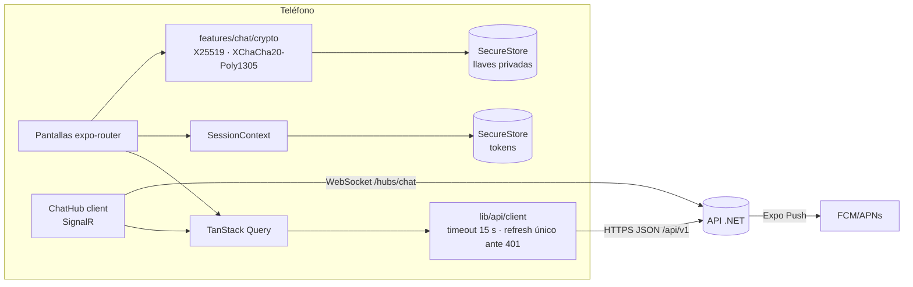

# Arquitectura — Encorely móvil (rama `rebuild/v1`)

App nativa Android/iOS con Expo SDK 57 (React Native 0.86, React 19.2, TypeScript estricto). La web de Expo no es objetivo. El back es `encorly_back` (.NET 10) y el contrato entre ambos es `encorly_back/contracts/openapi.v1.json`.

## Capas y carpetas

| Carpeta | Qué vive ahí | Regla |
|---|---|---|
| `src/app/` | Rutas de expo-router. Delgadas: importan la pantalla de su feature | Sin lógica de negocio |
| `src/features/<dominio>/` | Pantallas, componentes, hooks y lógica pura de cada dominio: `auth`, `onboarding`, `discover`, `events`, `match`, `chat`, `profile`, `safety`, `push`, `spotify` | Un dominio no edita archivos de otro; reutiliza por su `index.ts` |
| `src/ui/` | Design system "La boleta compartida": tokens, tema, primitivas, iconos | Única fuente de colores, tipos, espacios y radios |
| `src/lib/` | Configuración, cliente API, tipos del contrato, sesión, Query, red | Sin UI salvo el aviso de red |

## Navegación

`Stack` raíz con tres grupos protegidos por la sesión (`Stack.Protected`):

- `(auth)`: bienvenida, entrar, crear cuenta.
- `(onboarding)`: datos básicos y géneros. Se sale cuando el back marca `onboardingCompleted`.
- `(app)`: `Stack` con las tabs nativas (*Descubrir · Conciertos · Chats · Tú*) y, apiladas encima, las pantallas de detalle (concierto, match, chat, verificación, ajustes). Así hay swipe-back en iOS, la tab bar no tapa contenido y un push abre el chat con historial.

El splash se mantiene hasta resolver fuentes y sesión: no hay destello del login ni del onboarding.

## Sesión y red

- **Una sola sesión** (`lib/session/SessionContext.tsx`). En el dispositivo solo se guardan los tokens (SecureStore, `WHEN_UNLOCKED_THIS_DEVICE_ONLY`) y las llaves del chat. Todo lo demás sale del API: un teléfono compartido no filtra datos entre usuarios.
- **Refresh rotativo**: el cliente renueva el access token antes de que venza y, ante un 401, hace **un solo** refresh en vuelo (varias peticiones simultáneas no rotan varias veces, lo que haría que el back revocara la familia). Si el refresh es rechazado, la sesión se cierra con el aviso "Tu sesión se cerró" en vez de dejar la app colgada.
- Peticiones con timeout de 15 s, un reintento en GET ante corte de red, errores `ProblemDetails` traducidos a texto para la persona (nunca "API 401") y ramificación por `code` estable.
- TanStack Query para el estado de servidor, enlazado a NetInfo (reintenta al volver la red) y a AppState (refresca al volver a la app). Aviso "Sin conexión" global.
- Los tipos del cliente se **generan** del contrato: `pnpm gen:api` → `src/lib/api/schema.d.ts`; `types.ts` solo da nombres legibles.

## Chat cifrado de extremo a extremo

### Protocolo (v1)

| Pieza | Decisión |
|---|---|
| Identidad | Ed25519 por usuario y dispositivo, generada en el teléfono |
| Llave de caja | X25519 con `boxKeyId` creciente, firmada por la identidad: `Ed25519(“ENCORELY-BOXKEY-v1” ‖ u32be(boxKeyId) ‖ boxKey)`. El cliente **siempre** verifica la firma de las llaves que recibe |
| Llave del par | `HKDF-SHA256(X25519(mi_privada, publica_del_otro), salt = matchId, info = “ENCORELY-CHAT-v1”)` |
| Cifrado | XChaCha20-Poly1305 con nonce aleatorio de 24 B por mensaje |
| AAD | `“ENCORELY-MSG-v1” ‖ versión ‖ id ‖ 0 ‖ matchId ‖ 0 ‖ remitente ‖ 0 ‖ u32 llave del remitente ‖ u32 llave del destinatario`: el servidor no puede mover un mensaje a otra conversación ni cambiar su remitente sin que falle el descifrado |
| Texto interno | JSON `{v, id, m, s, r, t, k, b}` + llave de franking, con padding ISO/IEC 7816-4 a múltiplos de 256 B (oculta la longitud) |
| Franking | `HMAC-SHA256(fk, “ENCORELY-FRANK-v1” ‖ UUID ‖ texto interno)`: un reporte adjunta texto + `fk` y moderación comprueba que el mensaje es auténtico sin poder leer nada más |
| Código de seguridad | 60 dígitos (12 bloques de 5) derivados de SHA-256 de cada identidad, ordenados por userId; también como QR para escanear en persona |
| Librerías | `@noble/curves`, `@noble/ciphers`, `@noble/hashes` (JS puro, auditadas por Cure53). `crypto.getRandomValues` lo provee `expo-crypto` |

Todo el cifrado vive en `src/features/chat/crypto/envelope.ts`. Ningún `console.*` en `crypto/` ni `keys/` (regla de ESLint).

### Llaves en el dispositivo

- Privadas en SecureStore namespaced por usuario (`e2ee_v1_<userId>_…`), solo accesibles con el teléfono desbloqueado y excluidas del backup de Android.
- iOS conserva el Keychain tras desinstalar: un `installId` en AsyncStorage detecta la reinstalación y regenera llaves en vez de reutilizar las viejas.
- Las llaves de contactos se fijan (*pinning*): primera vez = sin verificar; misma identidad con caja nueva firmada = rotación normal; identidad distinta = **cambio**, que se avisa en el chat y, si el contacto estaba verificado, bloquea el envío hasta que la persona lo acepte.
- Al cerrar sesión las llaves se conservan (para leer el historial al volver a entrar en ese teléfono); al **borrar la cuenta** se destruyen.

### Modelo de amenazas

| Amenaza | ¿Protege la v1? | Por qué |
|---|---|---|
| Servidor curioso o admin de la BD | **Sí, el contenido** | Solo hay ciphertext. Sigue viendo quién habla con quién, cuándo y el tamaño aproximado (con padding a 256 B) |
| Volcado de la BD | **Sí** | Sin las llaves privadas el ciphertext no sirve |
| Volcado de la BD y luego robo de una llave privada | **No** | Sin forward secrecy, esa llave descifra lo capturado |
| Servidor que sustituye una llave pública | **Parcial** | Se detecta si comparan el código de seguridad (o el QR) en persona |
| MITM de red | **Sí** | TLS + E2EE |
| Robo de la contraseña | **Parcial** | El atacante publica una llave nueva: el contacto ve el aviso de cambio |
| Teléfono robado y bloqueado | **Sí** | Keystore/Keychain solo con desbloqueo |
| Teléfono desbloqueado o con malware | **No** | Ningún E2EE protege un dispositivo comprometido |
| Acoso o spam | **Parcial** | Chat solo con match mutuo, bloquear y reportar con franking |
| Notificaciones push | **Sí** | El payload no lleva contenido, nombre ni texto |

### Límites declarados (también en la app: *Tú → Cómo protegemos tus chats* y en la verificación)

- **Sin forward secrecy.** Quien robe la llave privada de tu teléfono puede descifrar lo que haya capturado antes y después.
- **Un solo teléfono.** Si reinstalas o cambias de teléfono se crea una llave nueva y los mensajes anteriores ya no se pueden leer.
- **Sin copia de seguridad** del historial ni de la llave, a propósito.
- **Verificación manual**: se compara el código o se escanea el QR en persona.
- El producto dice "cifrado de extremo a extremo", nunca "como Signal".

La infraestructura para rotar la llave de caja (`boxKeyId` creciente, llaves viejas conservadas para el historial) ya está; la rotación periódica que daría forward secrecy gruesa requiere historial local cifrado para no perder mensajes viejos (ver "Pendiente").

## Diseño: "La boleta compartida"

Tokens en `src/ui/tokens.ts` (paletas *venue* oscura y *papel* clara verificadas para AA, escala de 4 pt, 3 radios, Big Shoulders Display + Archivo + IBM Plex Mono, motion). La boleta con muesca (`TicketCard`) solo aparece en match, concierto y verificación del chat. Iconos Phosphor por imports profundos (`src/ui/icons.ts`). Sin emojis, gradientes de color, glow ni blur. Sin datos inventados: lo que no viene del API no se muestra.

## Pruebas

`pnpm verify` = `tsc` + ESLint + Jest. La cripto tiene pruebas de ida y vuelta, llave equivocada, bits alterados en ciphertext/nonce/AAD, sobre movido de conversación, remitente cambiado, franking manipulado, firma inválida, rotación y pinning.
