# Manual de usuario de Encorely

Versión de la app: 1.0.0 · Actualizado: 20 de octubre de 2026

Las capturas son de un teléfono Android con datos de demostración. Los conciertos, las personas y los mensajes que ves en ellas son ficticios.

## Contenido

1. [Qué es Encorely](#1-qué-es-encorely)
2. [Qué necesitas](#2-qué-necesitas)
3. [Primeros pasos](#3-primeros-pasos)
4. [Descubrir música](#4-descubrir-música)
5. [Conciertos y radar](#5-conciertos-y-radar)
6. [Matches](#6-matches)
7. [Chat privado](#7-chat-privado)
8. [Tu perfil y tu cuenta](#8-tu-perfil-y-tu-cuenta)
9. [Seguridad y privacidad](#9-seguridad-y-privacidad)
10. [Preguntas frecuentes](#10-preguntas-frecuentes)
11. [Glosario](#11-glosario)
12. [Pendientes detectados](#12-pendientes-detectados)

---

## 1. Qué es Encorely

Encorely te ayuda a encontrar con quién ir a tu próximo concierto.

Calificas canciones, marcas a qué concierto vas y ves quién más va y escucha lo mismo que tú. Si los dos se interesan, hacen match y pueden hablar por un chat privado.

Encorely es solo para mayores de 18 años.

## 2. Qué necesitas

- Un teléfono Android o iPhone.
- Conexión a internet (wifi o datos).
- Un correo electrónico al que tengas acceso.

La cuenta de Spotify es opcional.

## 3. Primeros pasos

### 3.1 Crear tu cuenta

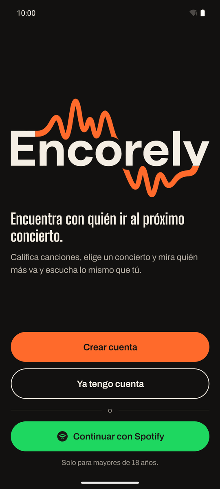 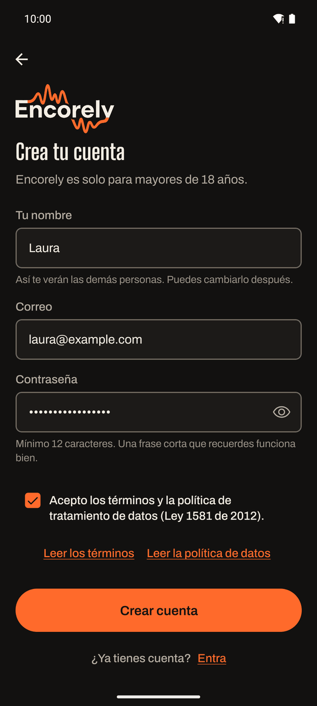

1. Abre Encorely y toca **Crear cuenta**.
2. Escribe tu nombre. Así te verán las demás personas y lo puedes cambiar después.
3. Escribe tu correo.
4. Crea una contraseña de mínimo 12 caracteres. Una frase corta que recuerdes funciona bien. Toca el ojo para ver lo que escribiste.
5. Lee los términos y la política de datos (los enlaces están debajo de la casilla) y marca la casilla para aceptarlos.
6. Toca **Crear cuenta**.

### 3.2 Cuéntanos de ti

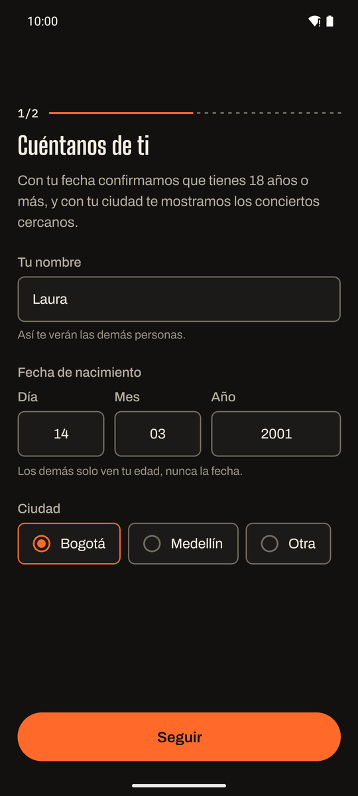 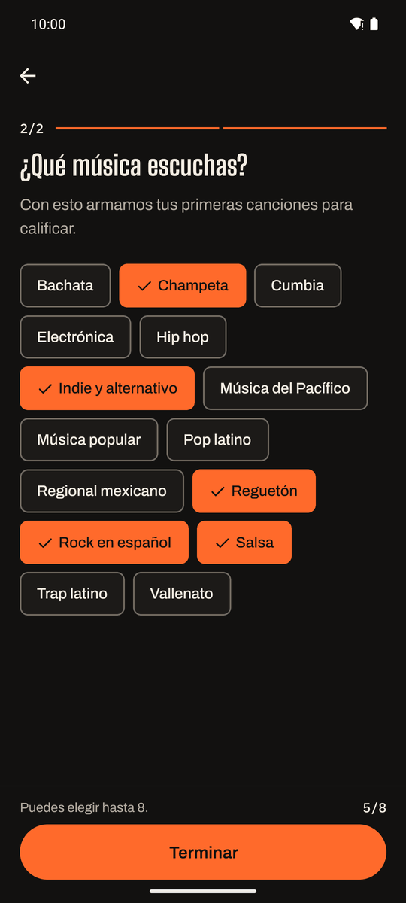

**Paso 1 de 2**

1. Revisa tu nombre.
2. Escribe tu fecha de nacimiento: día, mes (en número) y año. Con ella comprobamos que tienes 18 años o más. Los demás solo ven tu edad, nunca la fecha.
3. Elige tu ciudad: Bogotá, Medellín u Otra. Con ella te mostramos los conciertos cercanos.
4. Toca **Seguir**.

**Paso 2 de 2**

1. Toca los géneros que escuchas. Puedes elegir de 1 a 8.
2. Toca **Terminar**.

Con esos géneros armamos las primeras canciones que vas a calificar.

### 3.3 Entrar a tu cuenta

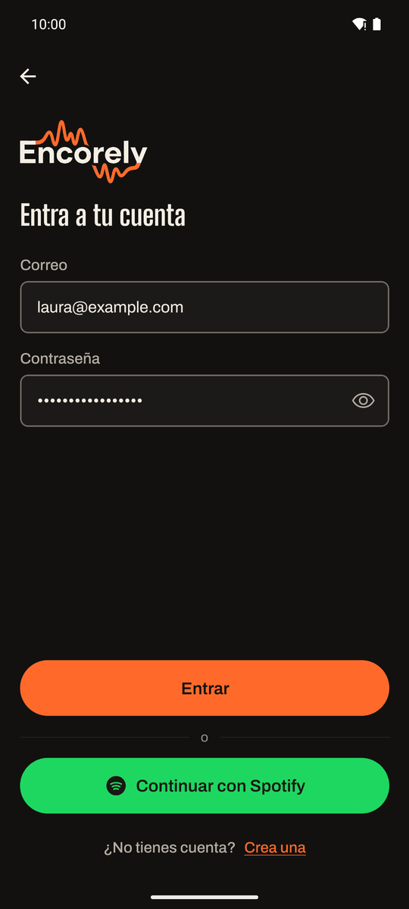

1. En la pantalla de bienvenida toca **Ya tengo cuenta**.
2. Escribe tu correo y tu contraseña.
3. Toca **Entrar**.

Si tu sesión vence, la app te avisa con el mensaje "Tu sesión se cerró". Vuelve a entrar y sigues donde ibas.

### 3.4 Conectar Spotify (opcional)

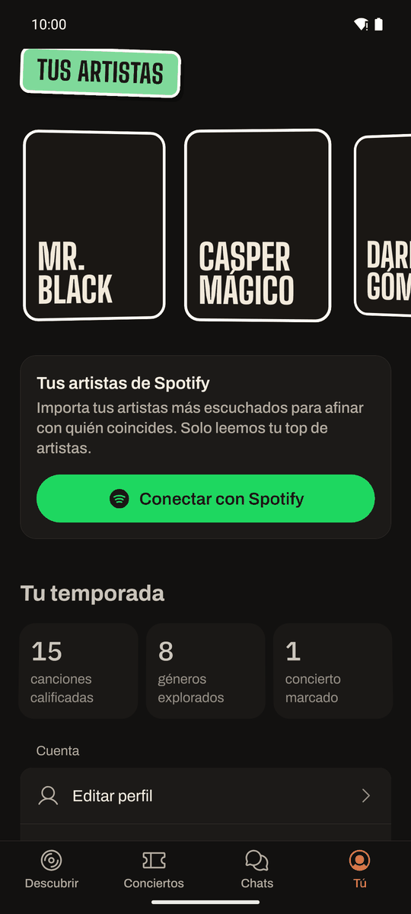

Spotify sirve para dos cosas, y las dos son opcionales:

- **Importar tus artistas.** En **Tú**, baja hasta *Tus artistas de Spotify* y toca **Conectar con Spotify**. Solo leemos tu lista de artistas más escuchados. Con eso afinamos con quién coincides.
- **Entrar sin contraseña.** En **Tú → Cuenta**, toca **Entrar con Spotify** para vincularlo. Después puedes entrar con **Continuar con Spotify** desde la bienvenida.

En los dos casos se abre la página de Spotify para que des el permiso, y luego vuelves a Encorely.

## 4. Descubrir música

### 4.1 Calificar canciones

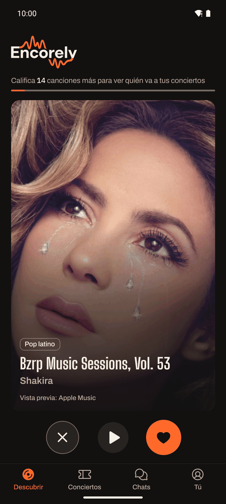 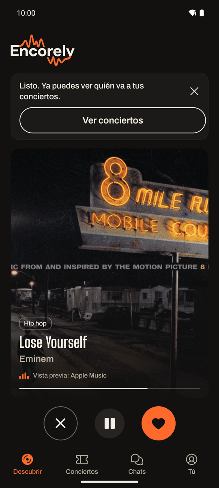

1. Abre la pestaña **Descubrir**.
2. Escucha la vista previa de 30 segundos. Empieza sola; con el botón del centro la pausas o la vuelves a reproducir.
3. Toca **♥ Me gusta** si te gusta la canción, o **✕ Paso** si no.
4. Sigue con la siguiente canción.

Arriba, la barra te dice cuántas canciones te faltan para ver quién va a tus conciertos. Cuando llegas, aparece el aviso **Listo. Ya puedes ver quién va a tus conciertos**. Toca **Ver conciertos** para ir directo.

Las vistas previas vienen de Apple Music.

### 4.2 Tu música

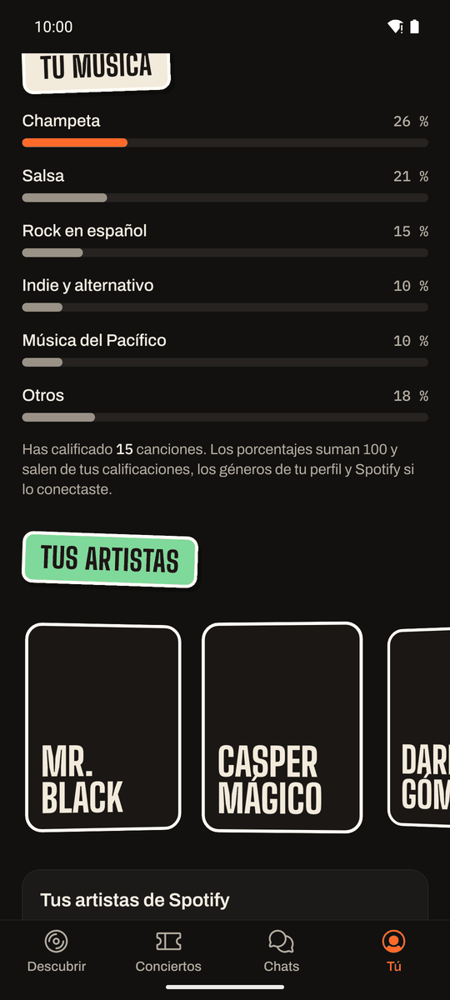

En **Tú**, la sección **Tu música** muestra qué tanto pesa cada género en tus gustos. Los porcentajes suman 100 y salen de:

- las canciones que calificaste,
- los géneros que elegiste en tu perfil,
- y tus artistas de Spotify, si lo conectaste.

Mientras más canciones califiques, más se parece a lo que de verdad escuchas. Debajo están **Tus artistas** y **Tu temporada**: canciones calificadas, géneros explorados y conciertos marcados.

## 5. Conciertos y radar

### 5.1 Ver los conciertos

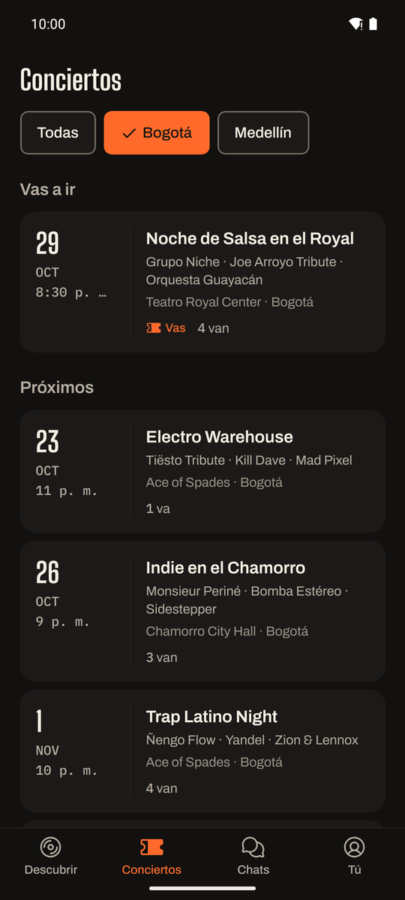

1. Abre la pestaña **Conciertos**.
2. Filtra por ciudad con **Todas**, **Bogotá** o **Medellín**.
3. Arriba están los conciertos a los que vas (**Vas a ir**). Debajo, los **Próximos**.

Cada concierto muestra la fecha, la hora, los artistas, el lugar y cuántas personas van.

### 5.2 Marcar que vas

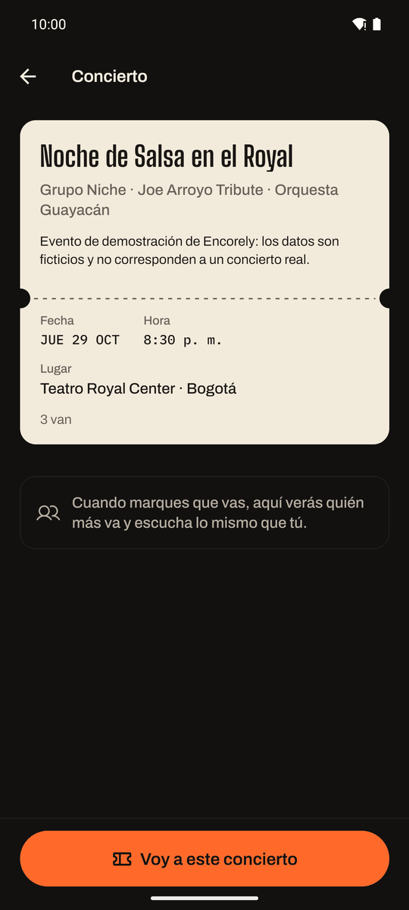

1. Toca un concierto para ver el detalle.
2. Toca **Voy a este concierto**.

La boleta queda marcada con **Vas a ir** y debajo aparece el radar. Si cambias de planes, baja hasta el final y toca **Ya no voy**.

### 5.3 El radar: quién más va

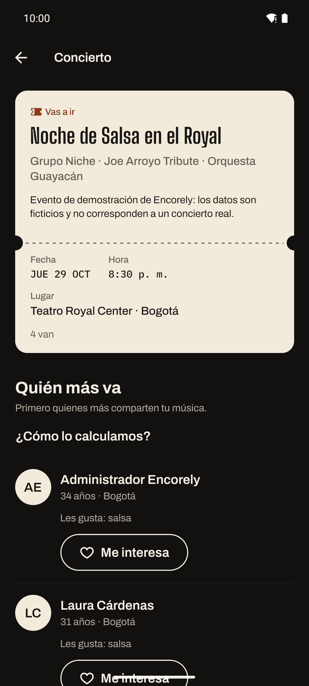 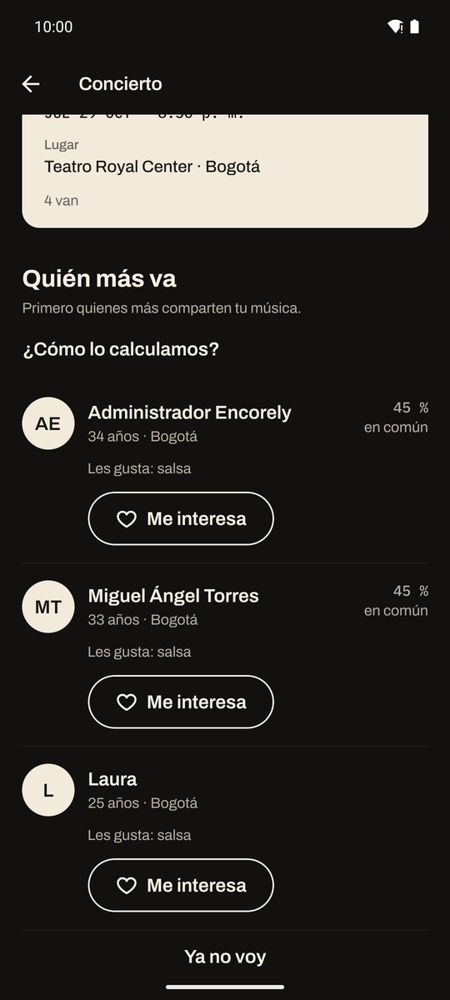

En **Quién más va** ves a las personas que marcaron el mismo concierto. Primero salen las que más comparten tu música.

De cada persona ves su nombre, edad, ciudad y lo que tienen en común ("Les gusta: salsa"). Cuando los dos han calificado suficientes canciones, también ves un porcentaje, por ejemplo **45 % en común**.

Para ver el perfil completo de alguien, toca su nombre.

### 5.4 Cómo calculamos lo que tienen en común

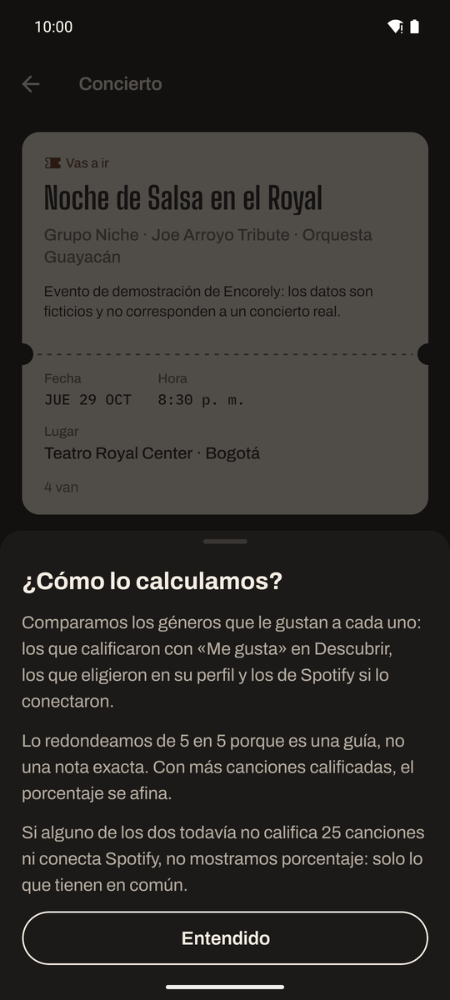

Toca **¿Cómo lo calculamos?** en el radar o en un perfil.

- Comparamos los géneros que le gustan a cada uno: los que calificaron con Me gusta, los que eligieron en su perfil y los de Spotify.
- El porcentaje se redondea de 5 en 5. Es una guía, no una nota exacta.
- Si alguno de los dos todavía no califica 25 canciones ni conecta Spotify, no mostramos porcentaje. Solo lo que tienen en común.

### 5.5 El perfil de otra persona

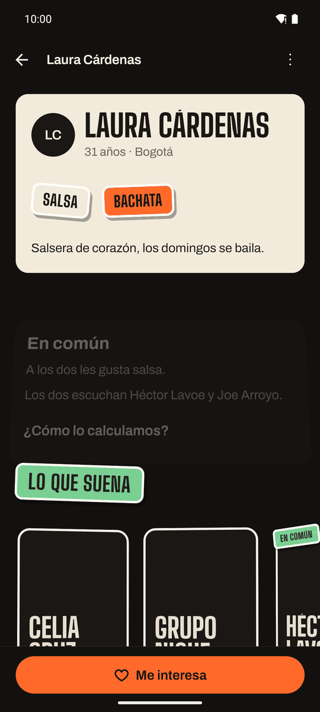

En el perfil de alguien ves:

- su nombre, edad, ciudad, géneros y la descripción que escribió;
- **En común**: lo que comparten;
- **Lo que suena**: sus artistas. Los que tienen en común llevan la etiqueta **En común**.

Con el menú **⋮** de arriba puedes bloquear o reportar a esa persona (ver [sección 9](#9-seguridad-y-privacidad)).

### 5.6 Me interesa

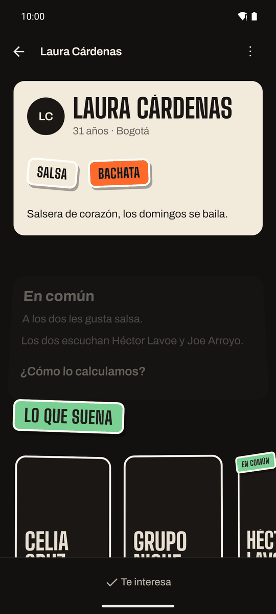

1. En el radar o en el perfil de alguien, toca **Me interesa**.
2. El botón cambia a **Te interesa**.

La otra persona no recibe ningún aviso por esto. Solo si ella también toca **Me interesa** contigo, hacen match.

Solo puedes tocar **Me interesa** con personas que van a un concierto que tú también marcaste.

### 5.7 Stickers: reaccionar a un gusto

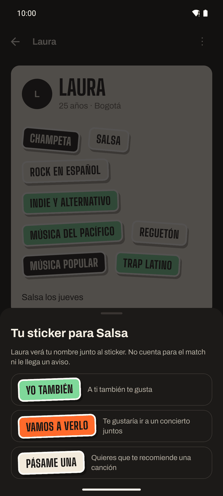 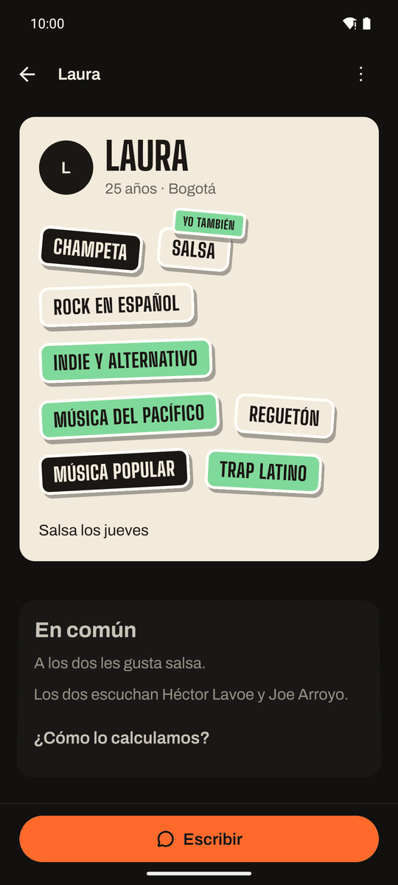

Puedes pegarle un sticker a un género o artista del perfil de otra persona.

1. Toca un género o un artista en su perfil.
2. Elige un sticker:
   - **Yo también**: a ti también te gusta.
   - **Vamos a verlo**: te gustaría ir a un concierto juntos.
   - **Pásame una**: quieres que te recomiende una canción.
3. El sticker queda pegado con tu elección.

La otra persona verá tu nombre junto al sticker. No cuenta para el match y no le llega un aviso.

## 6. Matches

### 6.1 Cuándo hay match

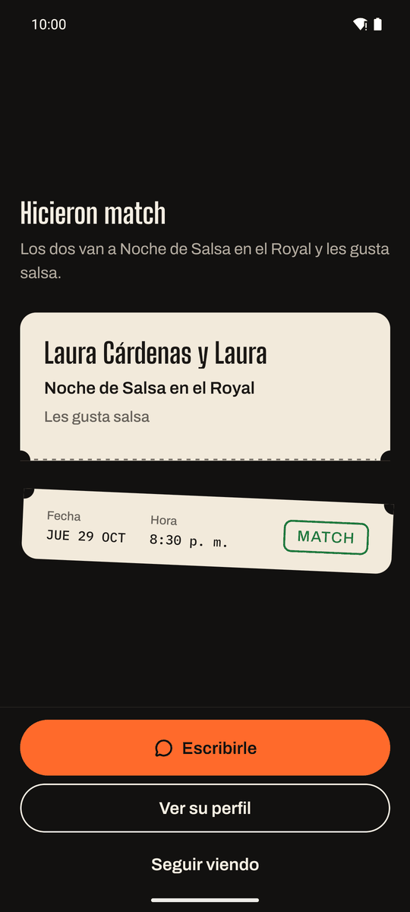

Hay match cuando **los dos** tocan **Me interesa**. Si solo uno lo hace, no pasa nada y nadie se entera.

Quien toca **Me interesa** de segundo ve la pantalla **Hicieron match**, con el concierto y lo que tienen en común. Desde ahí puede:

- **Escribirle**: abre el chat.
- **Ver su perfil**.
- **Seguir viendo**: vuelve a donde estaba.

La otra persona encuentra el match en su pestaña **Chats**.

### 6.2 Ver tus matches

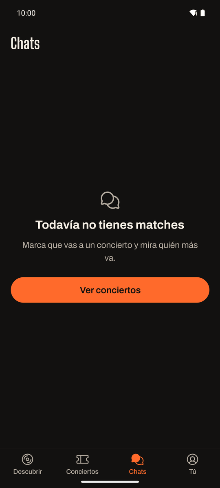 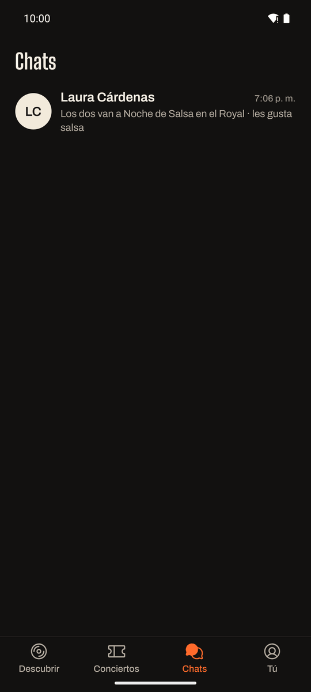

Todos tus matches están en la pestaña **Chats**. Cada uno muestra el nombre, el concierto que comparten y la hora del último mensaje. Toca uno para abrir la conversación.

Si todavía no tienes matches, la app te invita a marcar un concierto con **Ver conciertos**.

### 6.3 Deshacer un match

1. Abre el chat.
2. Toca **⋮** arriba a la derecha.
3. Toca **Deshacer match** y confirma.

La conversación se cierra para los dos y no podrán volver a escribirse.

## 7. Chat privado

### 7.1 Enviar mensajes

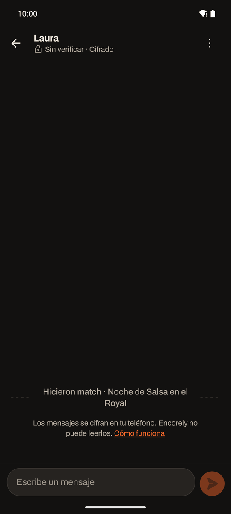 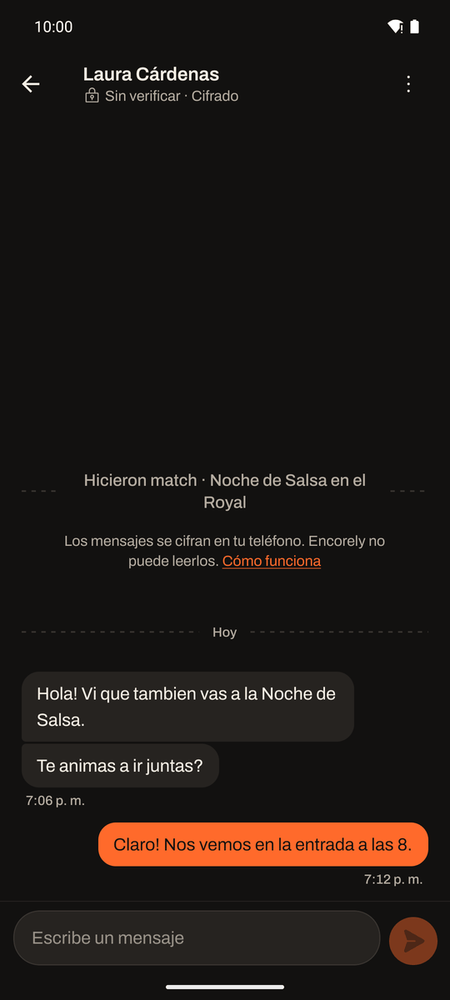

1. Abre el match desde **Chats** (o toca **Escribirle** en la pantalla del match).
2. Escribe en **Escribe un mensaje**.
3. Toca la flecha para enviar.

Arriba, debajo del nombre, ves el estado del chat: **Sin verificar · Cifrado** o **Verificado · Cifrado**.

### 7.2 Qué significa "cifrado de extremo a extremo"

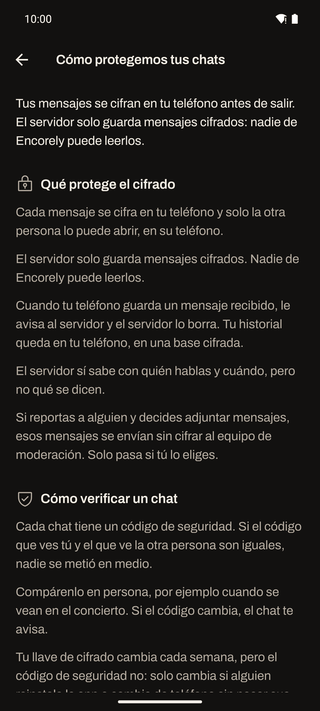

Piensa en cada mensaje como una carta dentro de una caja con candado:

- Tu teléfono cierra la caja antes de enviarla.
- Solo el teléfono de la otra persona tiene la llave para abrirla.
- Encorely lleva la caja de un teléfono al otro, pero no la puede abrir. Nadie de Encorely puede leer tus mensajes.

Además:

- Cuando el teléfono de la otra persona guarda tu mensaje, el servidor lo borra.
- Tu historial queda guardado en tu teléfono, también cifrado.
- Las notificaciones nunca muestran el contenido del mensaje.

Lo que el servidor **sí** sabe: con quién hablas y cuándo. No sabe qué se dicen.

Puedes leer esto mismo en la app: **Tú → Cómo protegemos tus chats**, o tocando **Cómo funciona** dentro de un chat.

### 7.3 Verificar el código de seguridad

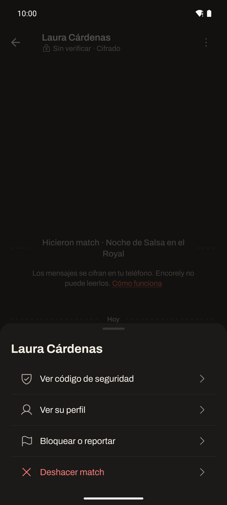 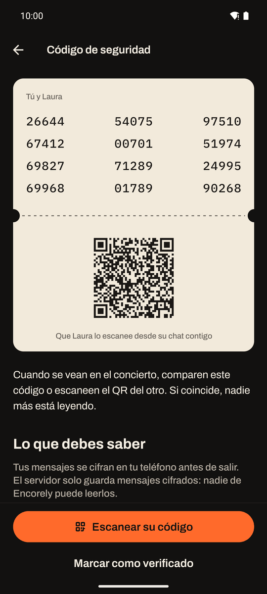

Cada chat tiene un código de seguridad de 60 números. Si el código que ves tú y el que ve la otra persona son iguales, nadie se metió en medio de su conversación.

1. En el chat, toca **⋮** y luego **Ver código de seguridad**.
2. Cuando se vean en persona (por ejemplo, en el concierto), comparen los 12 grupos de números. También pueden tocar **Escanear su código** y apuntar la cámara al QR del otro teléfono.
3. Si coinciden, toca **Marcar como verificado**.
4. Confirma con **Sí, coinciden**.

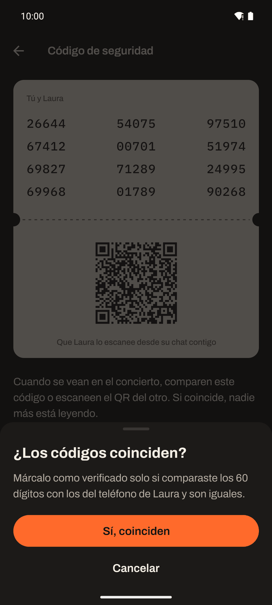 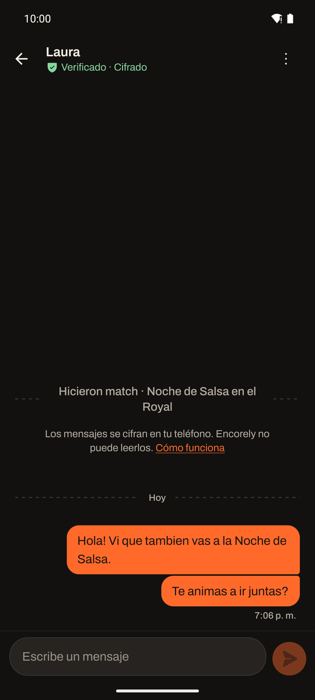

El chat pasa a **Verificado · Cifrado**.

Márcalo como verificado solo si de verdad comparaste los números. Si el código cambia más adelante, el chat te avisa. Pasa cuando la otra persona reinstala la app o cambia de teléfono sin pasar sus llaves. Si el chat estaba verificado, no podrás enviar mensajes hasta que aceptes el cambio. Antes de aceptarlo, pregúntale a la persona (mejor en persona) si de verdad cambió de teléfono.

### 7.4 Lo que el cifrado NO protege

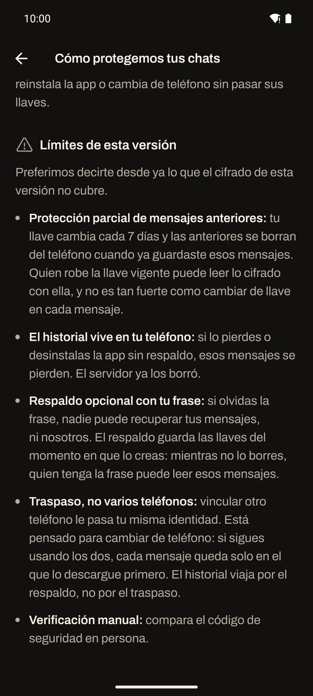

Preferimos que lo sepas desde ya:

- **La protección de mensajes anteriores es parcial.** Tu llave cambia cada 7 días, no con cada mensaje. Si alguien le roba a tu teléfono la llave de esta semana, podría leer los mensajes cifrados con ella.
- **El historial vive en tu teléfono.** Si lo pierdes o desinstalas la app sin un respaldo, esos mensajes se pierden. El servidor ya los borró y nadie te los puede devolver.
- **Un teléfono a la vez.** Tu cuenta de chat funciona en un solo teléfono. Puedes pasarla a uno nuevo (ver [7.6](#76-pasar-tus-chats-a-otro-teléfono)), pero si sigues usando los dos, cada mensaje queda solo en el que lo descargue primero.
- **Si reportas y adjuntas mensajes,** esos mensajes le llegan sin cifrar al equipo de moderación. Solo pasa si tú lo eliges.
- **Un teléfono desbloqueado no está protegido.** Si alguien usa tu teléfono desbloqueado, o el teléfono tiene un programa espía, puede ver tus chats. Ponle bloqueo de pantalla.
- **La verificación es manual.** El código solo sirve si lo comparan en persona.

### 7.5 Respaldo cifrado de tus chats

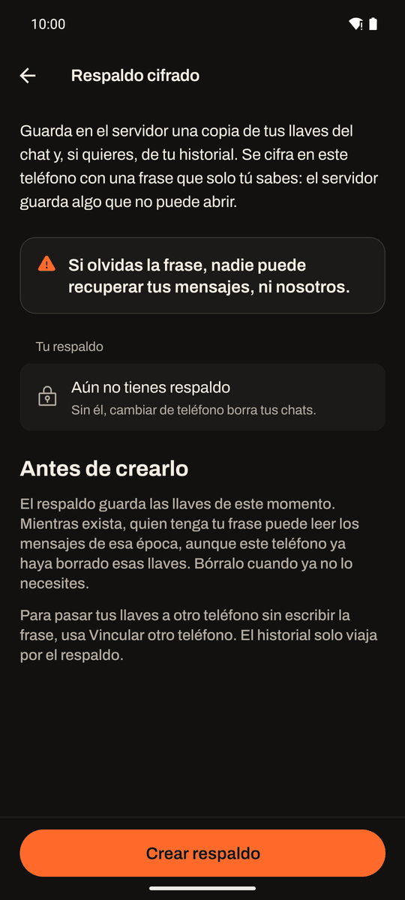 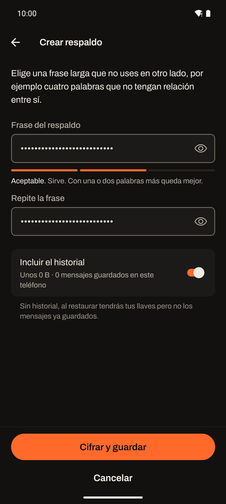

El respaldo guarda en el servidor una copia de tus llaves del chat y, si quieres, de tu historial. Se cifra en tu teléfono con una frase que solo tú sabes.

**Crear un respaldo**

1. Ve a **Tú → Respaldo cifrado de tus chats**.
2. Toca **Crear respaldo**.
3. Escribe una frase larga que no uses en otro lado. Por ejemplo, cuatro palabras que no tengan relación entre sí. Debajo ves qué tan fuerte es.
4. Repite la frase.
5. Activa **Incluir el historial** si quieres guardar también tus mensajes.
6. Toca **Cifrar y guardar** y espera. Puede tardar un poco.

**Restaurar en un teléfono nuevo**

1. Entra a tu cuenta en el teléfono nuevo.
2. Ve a **Tú → Respaldo cifrado de tus chats**.
3. Toca **Restaurar en este teléfono** y escribe tu frase.

Ten en cuenta:

- **Si olvidas la frase, nadie puede recuperar tus mensajes. Ni nosotros.**
- El respaldo guarda las llaves del momento en que lo creas. Mientras exista, quien tenga tu frase puede leer los mensajes de esa época. Bórralo cuando ya no lo necesites.

### 7.6 Pasar tus chats a otro teléfono

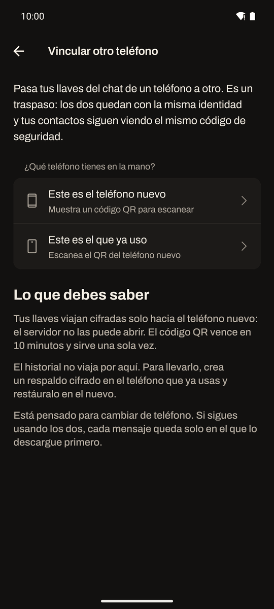

Si cambias de teléfono y tienes los dos a mano:

1. En el **teléfono nuevo**, entra a tu cuenta y ve a **Tú → Vincular otro teléfono**. Toca **Este es el teléfono nuevo**. Aparece un código QR.
2. En el **teléfono que ya usas**, ve a **Tú → Vincular otro teléfono** y toca **Este es el que ya uso**. Escanea el QR del teléfono nuevo.
3. Los dos teléfonos muestran un código de 6 números. Confirma en el teléfono nuevo solo si son iguales.

El QR vence en 10 minutos y sirve una sola vez. Así pasan tus llaves, y tus contactos siguen viendo el mismo código de seguridad. El historial **no** viaja por aquí: para llevarlo, usa el respaldo cifrado.

## 8. Tu perfil y tu cuenta

### 8.1 La pestaña Tú

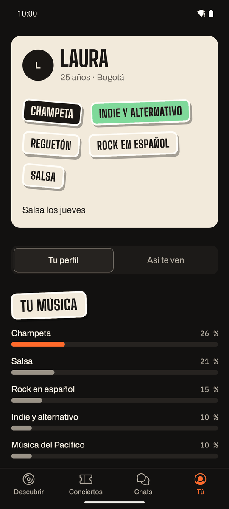 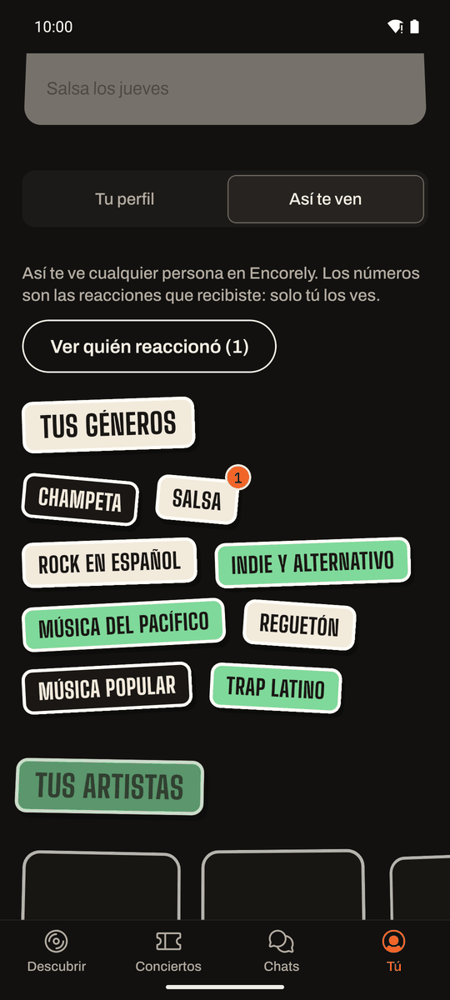

Arriba ves tu tarjeta: nombre, edad, ciudad, géneros y tu descripción. Tiene dos vistas:

- **Tu perfil**: tus datos, tu música, tus artistas y tu temporada.
- **Así te ven**: cómo te ve cualquier persona en Encorely. Los números sobre tus géneros son las reacciones que recibiste. Solo tú los ves.

### 8.2 Reacciones que recibiste

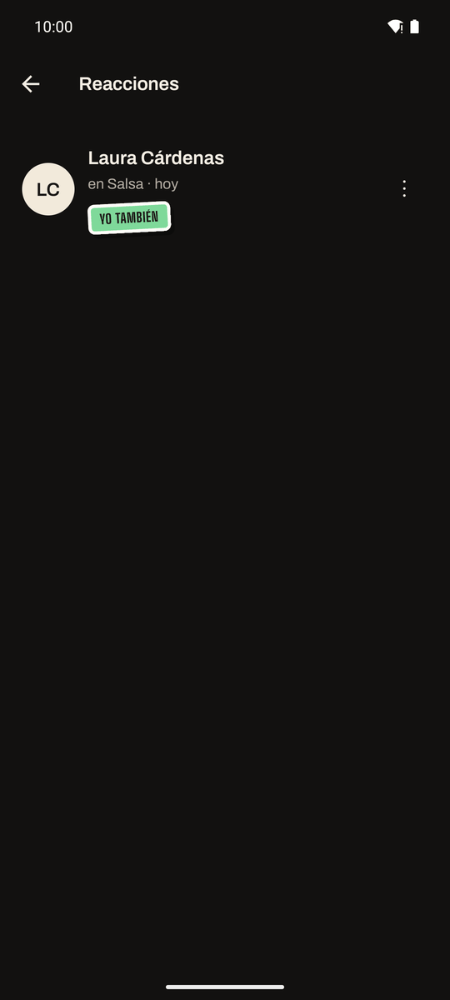

1. En **Así te ven**, toca **Ver quién reaccionó**. También está en **Tú → Reacciones que recibiste**.
2. Ves quién te pegó cada sticker, en qué gusto y cuándo.
3. Si alguien te incomoda, toca **⋮** en su fila para bloquearlo o reportarlo.

### 8.3 Editar tu perfil

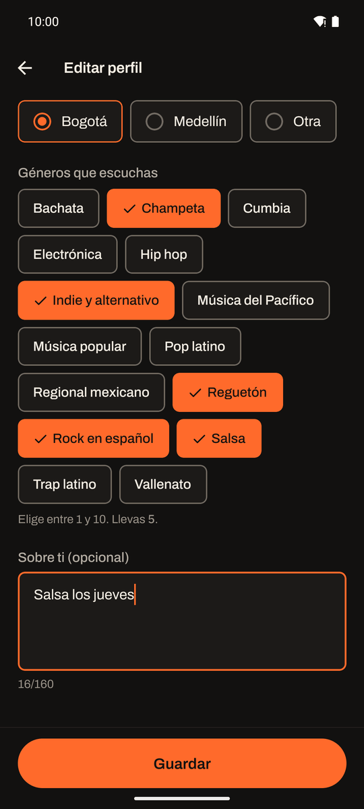

1. Ve a **Tú → Editar perfil**.
2. Cambia lo que quieras:
   - nombre,
   - fecha de nacimiento (debes tener 18 años o más),
   - ciudad,
   - géneros (de 1 a 10),
   - **Sobre ti**: una descripción opcional de hasta 160 caracteres.
3. Toca **Guardar**.

### 8.4 Ocultar tu perfil

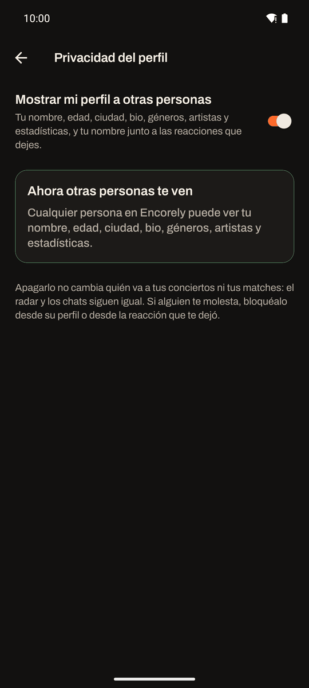

1. Ve a **Tú → Privacidad del perfil**.
2. Apaga **Mostrar mi perfil a otras personas**.

La app muestra **Ahora nadie más te ve** y nadie puede abrir tu perfil. Apagarlo no cambia el radar ni tus matches: siguen igual.

### 8.5 Notificaciones

Encorely te avisa cuando tienes un mensaje o un match nuevo. Los avisos nunca muestran el contenido del mensaje.

La primera vez que abres **Chats**, la app te ofrece activarlos con **Activar avisos**. Si tocaste **Ahora no** o los quieres apagar, hazlo desde los ajustes de tu teléfono, en la sección de notificaciones de Encorely.

### 8.6 Sesiones abiertas

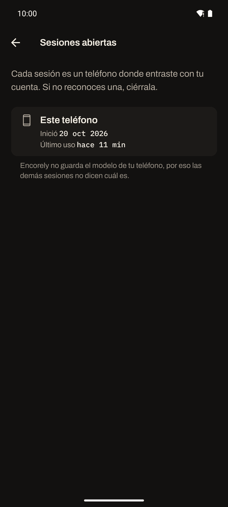

En **Tú → Sesiones abiertas** ves los teléfonos donde entraste con tu cuenta. Si no reconoces una sesión, ciérrala desde ahí.

### 8.7 Cerrar sesión

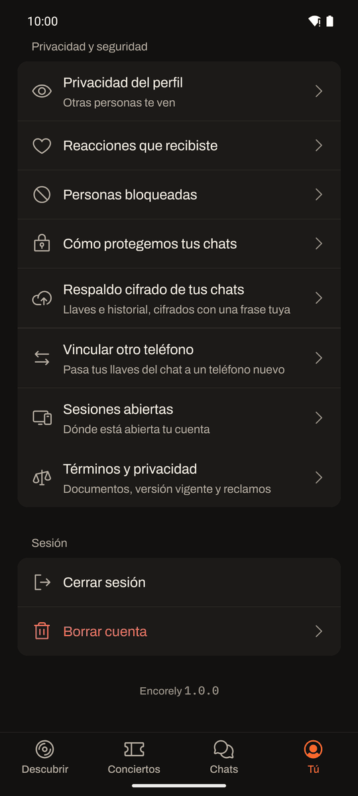 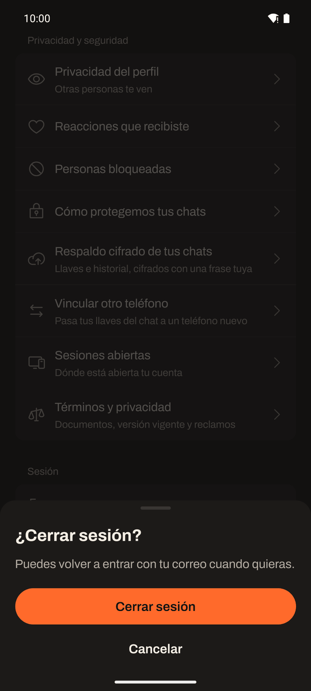

1. Ve a **Tú** y baja hasta **Sesión**.
2. Toca **Cerrar sesión** y confirma.

Tus llaves y tu historial de chats se quedan guardados en ese teléfono. Cuando vuelvas a entrar ahí, los vuelves a ver.

## 9. Seguridad y privacidad

### 9.1 Bloquear a alguien

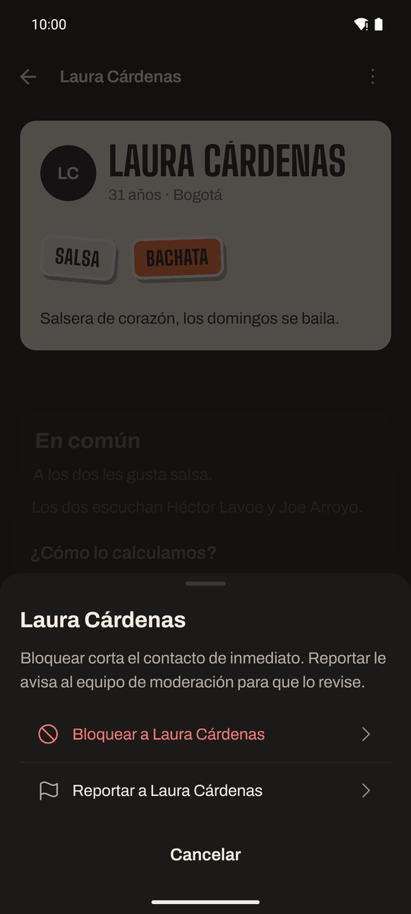 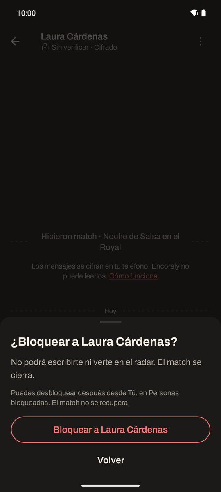

Puedes bloquear desde el perfil de la persona (**⋮**), desde el chat (**⋮ → Bloquear o reportar**) o desde la lista de reacciones.

1. Toca **Bloquear a** *nombre*.
2. Lee lo que pasa y confirma.

Al bloquear:

- esa persona no puede escribirte ni verte en el radar;
- el match se cierra y no se recupera, aunque luego desbloquees.

Para desbloquear, ve a **Tú → Personas bloqueadas**.

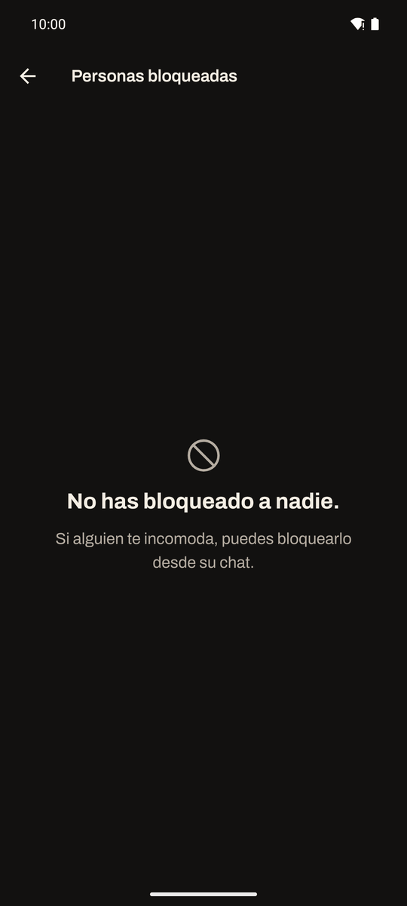

### 9.2 Reportar a alguien

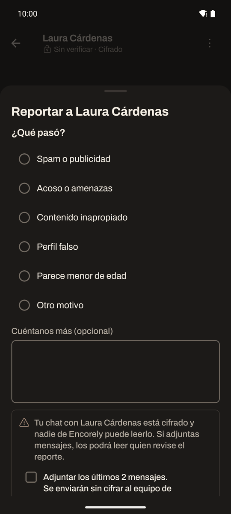

1. Toca **Reportar a** *nombre* (desde el perfil, el chat o las reacciones).
2. Elige qué pasó: spam o publicidad, acoso o amenazas, contenido inapropiado, perfil falso, parece menor de edad u otro motivo.
3. Si quieres, cuéntanos más.
4. Si reportas desde el chat, puedes marcar **Adjuntar los últimos mensajes**. Esos mensajes se envían sin cifrar al equipo de moderación para que pueda revisarlos.
5. Toca **Enviar reporte**.

El equipo de moderación revisa cada reporte.

### 9.3 Términos, privacidad y tus derechos

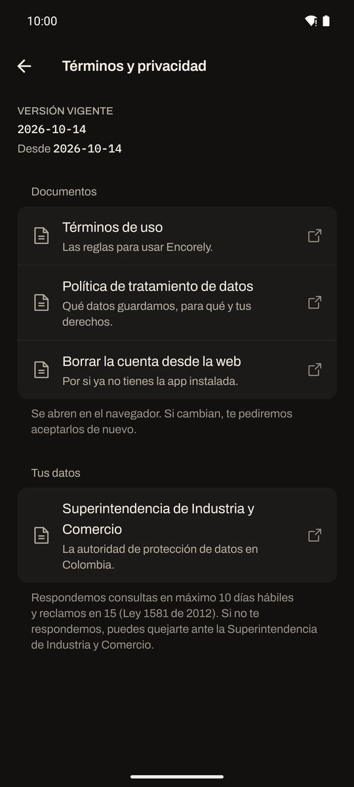

En **Tú → Términos y privacidad** encuentras:

- los **Términos de uso** y la **Política de tratamiento de datos** (se abren en el navegador);
- la versión vigente. Si cambian, te pedimos aceptarlos de nuevo;
- cómo reclamar. Respondemos consultas en máximo 10 días hábiles y reclamos en 15 (Ley 1581 de 2012). Si no te respondemos, puedes quejarte ante la Superintendencia de Industria y Comercio.

**Descargar tus datos:** en **Tú → Descargar mis datos** recibes una copia de tu información para guardarla o enviártela. No incluye tus mensajes, porque no los podemos leer.

### 9.4 Borrar tu cuenta

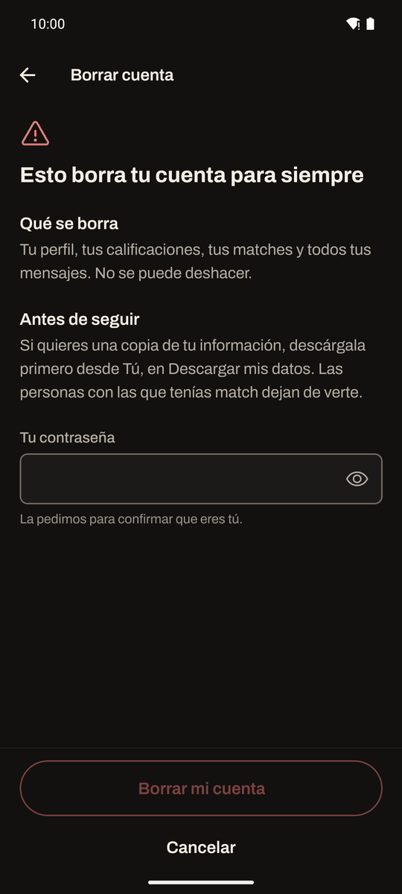

1. Si quieres una copia de tu información, descárgala antes desde **Tú → Descargar mis datos**.
2. Ve a **Tú → Borrar cuenta**.
3. Escribe tu contraseña para confirmar que eres tú.
4. Toca **Borrar mi cuenta**.

Qué se borra, para siempre:

- tu perfil, tus calificaciones, tus matches y todos tus mensajes;
- tus llaves del chat y el historial guardado en ese teléfono.

Las personas con las que tenías match dejan de verte. No se puede deshacer.

Si ya no tienes la app instalada, puedes borrar la cuenta desde la web: el enlace está en **Tú → Términos y privacidad → Borrar la cuenta desde la web**.

## 10. Preguntas frecuentes

**No veo a nadie en el radar.**
Revisa tres cosas:
1. Que marcaste **Voy a este concierto**. El radar solo aparece en los conciertos que marcaste.
2. Que calificaste las canciones que pide **Descubrir**. La barra de arriba te dice cuántas faltan.
3. Que alguien más marcó ese concierto. Si nadie más va todavía, el radar sale vacío. Prueba con otro concierto o vuelve más cerca de la fecha.

**No me aparece el porcentaje en común.**
Sale cuando los dos califican al menos 25 canciones o conectan Spotify. Mientras tanto ves solo lo que tienen en común.

**No puedo tocar Me interesa con alguien.**
Solo puedes hacerlo con personas que van a un concierto que tú también marcaste.

**Toqué Me interesa y no pasó nada.**
Es normal. El match solo aparece cuando la otra persona también toca **Me interesa** contigo.

**No me llegan las notificaciones.**
Revisa en los ajustes del teléfono que las notificaciones de Encorely estén activadas y que el teléfono no esté en modo ahorro de batería o No molestar. Aunque no lleguen, los mensajes te esperan en **Chats**.

**Perdí el teléfono o se me dañó.**
- Si tenías **respaldo cifrado**: entra a tu cuenta en el teléfono nuevo y restáuralo con tu frase (ver [7.5](#75-respaldo-cifrado-de-tus-chats)).
- Si no tenías respaldo: tu cuenta, tus matches y tu perfil siguen ahí, pero el historial del chat se pierde. Tus contactos verán que tu código de seguridad cambió.
- En los dos casos, revisa **Tú → Sesiones abiertas** desde el teléfono nuevo y cierra la del teléfono perdido.

**Desinstalé la app y no veo mis mensajes viejos.**
El historial vive en el teléfono. Sin respaldo, al desinstalar se pierde.

**El chat dice que el código de seguridad cambió.**
Casi siempre es porque la otra persona reinstaló la app o cambió de teléfono. Pregúntale, mejor en persona, y vuelvan a comparar el código.

**Olvidé mi contraseña.**
Por ahora la app no tiene una opción para recuperarla. Si vinculaste Spotify, puedes entrar con **Continuar con Spotify**.

**Olvidé la frase de mi respaldo.**
No se puede recuperar. Ve a **Tú → Respaldo cifrado de tus chats**, toca **Borrar respaldo** y crea uno nuevo con otra frase.

**La app dice "Sin conexión".**
Revisa tu wifi o tus datos. Cuando vuelva la conexión, la app se actualiza sola. Los mensajes guardados en tu teléfono los puedes leer sin conexión.

## 11. Glosario

| Palabra | Qué significa |
|---|---|
| **Match** | Cuando dos personas se tocaron **Me interesa**. Abre el chat entre las dos. |
| **Me interesa** | Lo que tocas para decir que quieres conocer a alguien. Si es mutuo, hay match. |
| **Radar** | La lista **Quién más va** dentro de un concierto que marcaste. |
| **En común** | Los géneros y artistas que comparten dos personas. |
| **Sticker** | Una reacción que pegas sobre un gusto de otra persona. No cuenta para el match. |
| **Vista previa** | Los 30 segundos de canción que suenan en Descubrir. |
| **Cifrado de extremo a extremo** | Tus mensajes se cierran en tu teléfono y solo se abren en el de la otra persona. Encorely no los puede leer. |
| **Llave** | El dato secreto que guarda tu teléfono para abrir tus mensajes. Cambia cada semana. |
| **Código de seguridad** | Los 60 números que comparan en persona para confirmar que nadie se metió en el chat. |
| **Verificado** | Comparaste el código de seguridad con la otra persona y coincidía. |
| **Respaldo cifrado** | Una copia de tus llaves (y, si quieres, tu historial) protegida con una frase que solo tú sabes. |
| **Vincular otro teléfono** | Pasar tus llaves del chat de tu teléfono viejo al nuevo con un código QR. |
| **Sesión** | Cada teléfono donde entraste con tu cuenta. |

## 12. Pendientes detectados

Cosas que encontramos al recorrer la app para este manual (20 de octubre de 2026, rama `Dev`, Android). No se documentaron como si funcionaran.

| # | Qué pasa | Dónde | Efecto en el manual |
|---|---|---|---|
| 1 | No hay forma de recuperar la contraseña: la pantalla de entrar no tiene "¿Olvidaste tu contraseña?". | Entrar | La pregunta frecuente dice que por ahora no existe. |
| 2 | La cuenta de administrador del seed (*Administrador Encorely*) aparece en el radar como cualquier persona y se le puede dar **Me interesa**. | Radar | Se usó la captura tal cual; es un dato de demostración. |
| 3 | Al volver del perfil de alguien al radar, el botón sigue diciendo **Me interesa** aunque ya lo tocaste. Se corrige al salir y volver a entrar al concierto. | Radar | No se menciona. |
| 4 | No hay un ajuste de notificaciones dentro de la app; solo la tarjeta **Activar avisos** en Chats. En local el push no está configurado, así que esa tarjeta no aparece y no hay captura. | Chats, Tú | Se explicó con el texto del código y se manda a los ajustes del teléfono. |
| 5 | Spotify no se pudo probar: el back local no tiene `SPOTIFY_CLIENT_ID`, pero la app sí abre el navegador hacia Spotify en vez de mostrar el aviso de "no disponible" que promete el README. | Tú, bienvenida | Se explicó el flujo sin capturas del paso en Spotify. |
| 6 | **Descargar mis datos** abre el menú de compartir con un texto en formato JSON. Para alguien no técnico es difícil de leer. | Tú | Se describe como "una copia de tu información". |
| 7 | En el perfil de otra persona, la tarjeta **En común** se ve atenuada en el emulador. Puede ser la animación de entrada con render por software; falta confirmarlo en un teléfono real. | Perfil ajeno | Captura usada tal cual. |
| 8 | **Escanear su código** (QR) y el flujo de **Vincular otro teléfono** completo no se probaron: necesitan cámara y dos teléfonos. | Chat, Tú | Pasos escritos a partir de los textos de la app, sin capturas del escaneo. |
| 9 | El plan del manual pedía explicar "sin forward secrecy, un solo dispositivo". La app actual ya rota la llave cada 7 días y permite traspasar a otro teléfono. | Chat | El manual sigue lo que dice la app (*Límites de esta versión*). |
